# Mekanism for Minecraft 26.3 #

Mekanism is an independent Minecraft add-on featuring high-tech machinery that can be used to create powerful tools, 
armor, and weapons. You can find more detail on the features on the [**Official Wiki**](https://wiki.aidancbrady.com/wiki/Mekanism).
With features ranging from jetpacks and balloons to factories and energy cubes, the mod does not have a single unifying goal.
Nevertheless, these features combine coherently to create a rich gameplay experience that players will enjoy.

Mekanism uses a tier-based system to organize the majority of its core features, like energy cubes and factories.
There are four tiers: basic, advanced, elite, and ultimate. Players can upgrade their components to the next tier
by placing each component in a crafting grid and surrounding it with the necessary resources for the upgrade or in
world by using tier installers.

After using Mekanism for a while, players can obtain a near-indestructible suit of Refined Obsidian Armor, receive five 
ingots for each ore mined, fly with hydrogen-powered jetpacks, and have cute robotic friends following them around while they mine. :)

# Alpha Status #

Mekanism for 26.3 is currently in an alpha state. There may be crashes or game-breaking bugs, as well as,
the potential for us making breaking changes where APIs may change slightly or how data is saved to the world changes.
For this reason we do not recommend including Mekanism in any "large" packs that players may expect things to work
properly/upgrade safely from one version to the next.

### Known Issues/Things that we haven't finished implementing yet ###
- Docs for registering Chemicals
- Updated docs for changes in recipe serialization
- Rebalanced energy consumption and storage values for gear, and some misc blocks
- Machines with energy that are broken display that they have more energy stored than their capacity
- Various feature requests that may require making breaking changes to some parts of the API


# Building and Installing #

This branch builds Mekanism for both **NeoForge** and **Fabric** from the same sources (see [docs/multiloader.md](docs/multiloader.md)).
The Fabric port is an experimental, community maintained port and is not an official Mekanism release; see
[docs/fabric-port-status.md](docs/fabric-port-status.md) for what works and what is still missing.

### Prerequisites ###
- A JDK to run Gradle (21 or newer works). The build compiles with a **Java 25** toolchain; Gradle downloads it automatically
  if it can't find one installed.
- Git. On Windows, enable long paths before cloning, as some generated data paths are very deep: `git config --global core.longpaths true`
- Python 3 (as `python`, or set the `PYTHON` environment variable), but only for `./gradlew :fabric:build` and `:fabric:check`, which run
  the `checkInjectedInterfaces` check. Building the jars with `assemble` doesn't need Python.

### Compiling the jars ###
Use `./gradlew` (`gradlew.bat` on Windows) from the repository root:

```sh
./gradlew :fabric:assemble     # Fabric jars
./gradlew :neoforge:assemble   # NeoForge jars
```

Use `build` instead of `assemble` to also run the tests and checks. Jars from a local build are versioned `homebaked`
(`<version>` below is e.g. `26.3-10.8.0.homebaked`).

| Module               | Fabric (`fabric/build/libs/`)                 | NeoForge (`neoforge/build/libs/`)       |
|----------------------|-----------------------------------------------|-----------------------------------------|
| Mekanism (required)  | `Mekanism-fabric-<version>.jar`               | `Mekanism-<version>.jar`                |
| Mekanism: Generators | `MekanismGenerators-fabric-<version>.jar`     | `MekanismGenerators-<version>.jar`      |
| Mekanism: Additions  | `MekanismAdditions-fabric-<version>.jar`      | `MekanismAdditions-<version>.jar`       |
| Mekanism: Tools      | `MekanismTools-fabric-<version>.jar`          | `MekanismTools-<version>.jar`           |
| All four in one jar  | (none)                                        | `Mekanism-<version>-all.jar`            |

The `-sources` jars (both loaders) and the NeoForge `-api` jar are for developers; don't put them in your `mods` folder.
Generators, Additions and Tools each require the main Mekanism jar.

### Installing on Fabric ###
For Minecraft **26.3**, put these in your `mods` folder:
- [Fabric Loader](https://fabricmc.net/use/) **0.20.1** or newer
- [Fabric API](https://modrinth.com/mod/fabric-api) (built against 0.166.0+26.3)
- `Mekanism-fabric-<version>.jar`, plus any of the Generators, Additions and Tools jars you want

Forge Config API Port (26.3.1) and Team Reborn Energy (5.0.0) are bundled inside the Mekanism jar, so you don't need to install them.

Optional integrations, used when the mod is installed:
[JEI](https://modrinth.com/mod/jei), [Jade](https://modrinth.com/mod/jade), [The One Probe](https://modrinth.com/mod/the-one-probe),
[WTHIT](https://modrinth.com/mod/wthit) (which itself needs [Bad Packets](https://modrinth.com/mod/badpackets))
and [CC: Tweaked](https://modrinth.com/mod/cc-tweaked).
Other integrations of the NeoForge version, such as CraftTweaker or Curios, are not ported to Fabric yet unless listed in
[docs/fabric-port-status.md](docs/fabric-port-status.md).

### Installing on NeoForge ###
For Minecraft **26.3**, install [NeoForge](https://neoforged.net/) **26.3.0.102** or newer, then put either `Mekanism-<version>.jar`
plus the module jars you want, or only `Mekanism-<version>-all.jar` (never both), in your `mods` folder.

### Development runs ###
- Fabric: `./gradlew :fabric:runClient`, `:fabric:runServer`, `:fabric:runGameTestServer` (game tests) and `:fabric:runGameTestClient`
- NeoForge: `./gradlew :neoforge:runClient`, `:neoforge:runData` (datagen) and `:neoforge:runGameTestServer`


# Discord #

Mekanism has a [discord server](https://discord.gg/nmSjMGc) where you can chat with other Mekanism users and the developers. Join us!

# Translating #

If you would like to help translate Mekanism, you can do so through [Crowdin](https://mekanism.crowdin.com/u/projects/1).

# License #

Mekanism is licensed under the MIT license. You may use it in modpacks, reviews, or any other form as long as you abide by the terms below. 

Copyright 2017-2025 Aidan C. Brady

Permission is hereby granted, free of charge, to any person obtaining a copy of this software and associated documentation files (the "Software"), to deal in the Software without restriction, including without limitation the rights to use, copy, modify, merge, publish, distribute, sublicense, and/or sell copies of the Software, and to permit persons to whom the Software is furnished to do so, subject to the following conditions:

The above copyright notice and this permission notice shall be included in all copies or substantial portions of the Software.

THE SOFTWARE IS PROVIDED "AS IS", WITHOUT WARRANTY OF ANY KIND, EXPRESS OR IMPLIED, INCLUDING BUT NOT LIMITED TO THE WARRANTIES OF MERCHANTABILITY, FITNESS FOR A PARTICULAR PURPOSE AND NONINFRINGEMENT. IN NO EVENT SHALL THE AUTHORS OR COPYRIGHT HOLDERS BE LIABLE FOR ANY CLAIM, DAMAGES OR OTHER LIABILITY, WHETHER IN AN ACTION OF CONTRACT, TORT OR OTHERWISE, ARISING FROM, OUT OF OR IN CONNECTION WITH THE SOFTWARE OR THE USE OR OTHER DEALINGS IN THE SOFTWARE.

# Maven #
Mekanism v10+ is also available via [ModMaven](https://modmaven.dev/) for developers wishing to make use of our API. Big thanks to K4Unl for hosting.

Update your `build.gradle` file to include the following: 

```groovy
repositories {
    maven { url 'https://modmaven.dev/' }
}

dependencies {
    compileOnly "mekanism:Mekanism:${mekanism_version}:api"
    
    // If you want to test/use Mekanism & its modules during `runClient` invocation, use the following
    runtimeOnly fg.deobf("mekanism:Mekanism:${mekanism_version}")// Mekanism
    runtimeOnly fg.deobf("mekanism:Mekanism:${mekanism_version}:additions")// Mekanism: Additions
    runtimeOnly fg.deobf("mekanism:Mekanism:${mekanism_version}:generators")// Mekanism: Generators
    runtimeOnly fg.deobf("mekanism:Mekanism:${mekanism_version}:tools")// Mekanism: Tools
}
```

Add the following to your `gradle.properties` file (see [Maven](https://modmaven.dev/mekanism/Mekanism/) for the list of available versions):

```properties
mekanism_version=1.21.1-10.7.15.80
```

# Credits #

  * [aidancbrady](https://twitter.com/aidancbrady) - [Patreon](https://www.patreon.com/user?u=260704)
  * thommy101
  * [thiakil](https://twitter.com/thiakil)
  * [pupnewfster](https://twitter.com/pupnewfster) - [Patreon](https://www.patreon.com/pupnewfster), [Ko-fi](https://ko-fi.com/pupnewfster)
  * dizzyd  
  * unpairedbracket
  * [CyanideX](https://twitter.com/theCyanideX) (artwork)
  * [Ridanisaurus](https://twitter.com/Ridanisaurus) (artwork)
  * Cheapshot (artwork)
  * Archadia (artwork)
  * micdoodle
  * Bluexin
  * JaSpr